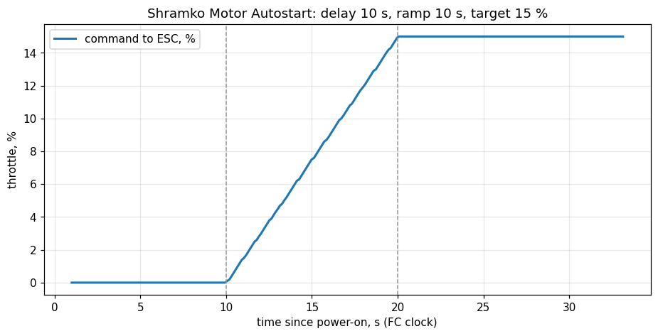

# Shramko Motor Autostart — Betaflight firmware that spins a motor on power-up, no receiver needed

**Plug in the battery → wait 10 s → the motor ramps up smoothly over 10 s to the throttle you set → it keeps running until you unplug.**
No transmitter, no receiver, no switch. A small, tested module for **Betaflight 2025.12.1** that turns any Betaflight flight controller into a standalone, configurable **motor / ESC driver** for blowers, fans, pumps, test stands and art installations — with DShot or PWM, and every number changeable from the Betaflight CLI without rebuilding.

Optional extras: a **single momentary push-button on two pads** (internal pull-up, no resistors or diodes), and a **standard RC receiver** (stock Betaflight behaviour, or an AUX switch that starts the same program).



*Measured on the real flight controller over USB: ramp starts at 10.0 s, reaches 15 % at 20.0 s, linearity R² = 0.9999, max deviation 1 µs.*

## Questions this answers

- How do I spin a brushless motor with Betaflight **without a receiver or transmitter**?
- Can a flight controller **start a motor automatically on power-up** after a delay?
- How do I make a **soft-start / slow linear throttle ramp** for an ESC (e.g. 0 → 15 % over 10 s)?
- How can I use a **flight controller as a fan or blower controller** with DShot and BLHeli_32 / AM32 ESCs?
- How do I start a motor program with **one push-button soldered to two pads**, no extra electronics?
- Why won't Betaflight arm without a receiver, and what is the safe workaround?
- How do I wire a **Flycolor X-Cross HV3 160A** ESC to an **HGLRC F405 8S** flight controller?

## Why it exists

Built by [Andrii Shramko](#author--working-together) for the **META4 Tornado case**: a sealed 360° camera rig for storm chasing, where a blower must clear water from the optics as soon as the box is powered — nobody can reach a transmitter there. Stock Betaflight cannot do this: it refuses to arm without a valid receiver link, the CLI `motor` command only lasts while a computer is connected, INAV and ArduPilot have no target for this board (and no GPIO button input / no Lua on 1 MB F405), and BLHeli_32 has no autostart. Nothing on GitHub did it, so this module was written, reviewed and measured on hardware.

## How it works

The module writes the throttle into the same place the Configurator **Motors tab** uses while disarmed (`motor_disarmed[]`), so the stock output path stays untouched: DShot/PWM drivers, the ESC's stop-command arming at boot, bidirectional DShot telemetry. A 50 Hz task runs a tiny state machine:

`IDLE → DELAY (countdown) → RAMP (linear) → RUN (hold)`

**Battery gate.** ESCs without a BEC wake up only when the battery is plugged in, and a BLHeli_32 ESC will not arm if it powers up into a non-zero throttle. The board measures the battery voltage on its `B` pin, so the countdown starts **when the battery appears** (on battery-only power that is the boot itself). Unplugging the battery for > 0.5 s stops the program; plugging it back in starts the countdown again. That is what makes "hot" bench testing with the USB cable attached safe and predictable.

Arbitration, highest priority first:
1. **Armed** by a receiver, 3D mode, or (optionally) a **computer connected** → the program stops and stock Betaflight owns the motors.
2. **Receiver link valid** for 0.5 s → stock Betaflight; an AUX switch (`autostart_box`) can run the same program.
3. **No receiver** → `POWER` mode starts the program at boot; a **button click** starts it, the next click stops it.

Safety: never drives before 3 s of uptime (the ESC always sees ≥ 3 s of stop frames to arm), never takes a pin owned by another driver, generic default is `OFF` (only the project board config enables `POWER`).

## CLI settings

| Setting | Default (this build) | Range | Meaning |
|---|---|---|---|
| `autostart_mode` | `POWER` | `OFF`, `POWER`, `BUTTON` | `POWER`: start after boot. `BUTTON`: wait for a click. `OFF`: stock Betaflight |
| `autostart_delay` | `10` | 0–600 s | delay before the ramp, counted **from power-on** (POWER) or from the click |
| `autostart_ramp` | `100` | 0–6000 (0.1 s) | ramp time 0 → target; `100` = 10.0 s |
| `autostart_throttle` | `15` | 0–100 % | target throttle, % of the ESC range (1000–2000 µs / DShot 48–2047) |
| `autostart_motors` | `1` | bitmask | `1` = motor 1, `3` = motors 1+2, `15` = 1–4 … |
| `autostart_vbat_min` | `60` | 0–600 (0.1 V) | battery counts as plugged in at ≥ 6.0 V; countdown starts then. `0` = don't check |
| `autostart_usb_inhibit` | `OFF` (generic builds: `ON`) | `OFF`, `ON` | `ON`: never spin while a USB host is connected |
| `autostart_box` | `255` (none) | 40–43 | `BOXUSER1..4` permanent id: an AUX switch runs the program while the receiver link is valid |
| `resource AUTOSTART 1 <pin>` | none | any free pin | push-button between that pad and GND (internal pull-up) |
| `debug_mode = AUTOSTART` | on in this build | — | debug[0..7] = state, % ×10, ms in state /10, uptime 0.1 s, flags (USB·RX·button·battery), battery 0.1 V, time since battery 0.1 s, source |

Change the target to 80 %:

```
set autostart_throttle = 80
save
```

## Wiring (HGLRC F405 8S V2 + Flycolor X-Cross HV3 160A, 6S)


- ESC **yellow** (middle pad `S`) → FC connector `4321RCGB` pin **`1`** (motor 1, PC9); ESC **black** (pad `GND`) → pin **`G`**.
- FC power: a thin pair from the same 6S battery → pins **`B`** and **`G`** (the ESC has no BEC). **Max 8S on `B`.**
- Optional button: top-side pads **`RX4`** (PA1) + the **`GND`** pad next to it → `resource SERIAL_RX 4 NONE`, `resource AUTOSTART 1 A01`.
- Correct wiring = on battery the ESC plays 3 rising tones, then 1 low + 1 high tone (signal seen, armed).

Details and sources: [docs/wiring.md](docs/wiring.md).

## Install

1. Download the `.hex` from [Releases](https://github.com/AndriiShramko/shramko-betaflight-motor-autostart/releases) (or build it, below).
2. Flash with Betaflight Configurator (*Load firmware [Local]*) or `python tools/flash_dfu.py COM6 firmware.hex` (STM32CubeProgrammer CLI, no Configurator).
3. **Remove the propeller**, then check the settings in the CLI (`get autostart`). Flashing this firmware over another Betaflight resets all settings once (Betaflight does that when a parameter group is added) — this build's defaults already are the project settings (DShot300, bidirectional DShot, autostart 10 s / 10 s / 15 %).
4. Bench check over USB (no battery: `set autostart_vbat_min = 0`), or "hot" with the battery and ESC attached (props off):
   `python tools/autostart_selftest.py COM6 --plot ramp.png` — reboots the board and prints PASS/FAIL, the curve and, from the ESC's bidirectional-DShot telemetry, the motor RPM and the battery voltage.

## Verified on hardware (2026-10-19, HGLRC F405 8S V2, no ESC)

| Test | Result |
|---|---|
| Reconstructed board config vs vendor firmware | `dump hardware` identical (except compass support) |
| Power-on, 10 s / 10 s / 15 % | starts 10.0 s, target at 20.0 s, plateau 1150 µs exact, R² 0.9999 |
| 3 s / 5 s / 80 % | starts 3.0 s, target at 8.0 s, plateau 1800 µs, slope 160.2 µs/s |
| `autostart_usb_inhibit = ON` with USB connected | motor stays at stop (negative control) |
| `autostart_mode = OFF` | motor stays at stop (negative control) |
| No battery (USB only), battery gate 6.0 V | motor stays at stop (negative control) |
| Battery gate off, final firmware | starts 10.06 s, target at 19.95 s, max deviation 1.0 µs |
| Bidirectional DShot ON | same curve; telemetry correctly reports "no ESC" |

Raw data: [docs/selftest/](docs/selftest/). 21 unit tests of the state machine (incl. battery plugged later / unplugged / glitch) (Betaflight googletest harness) + regression tests of the touched modules: `docker run --rm -v "$PWD:/repo" shramko-bf-build:2025.12.1 bash /repo/build/test.sh`.

## Build from source

```
docker build -t shramko-bf-build:2025.12.1 build
docker run --rm -v "$PWD:/repo" shramko-bf-build:2025.12.1 bash /repo/build/build.sh HGLRC_F405_S8
```

Output: `out/betaflight_2025.12.1_STM32F405_HGLRC_F405_S8_autostart.hex`. For another board, copy its `config.h` from [betaflight/config](https://github.com/betaflight/config) into `configs/<BOARD>/` and add `#define USE_AUTOSTART` (plus the `AUTOSTART_DEFAULT_*` values you want).

## Limitations

- Not a flight firmware configuration: use it to drive motors on the ground.
- BLHeli_32 ESCs can still be configured (BLHeliSuite32 32.10) but no longer flashed; if an ESC reports "activation failed" it accepts PWM only — set `motor_pwm_protocol = PWM`.
- The HGLRC F405 8S pin map comes from the vendor's diagram and silkscreen; HGLRC publishes no schematic.

## Author & working together


**Andrii Shramko** — I build drone and 360° camera systems for extreme shoots (storm chasing, city-scale 3D/4D Gaussian-splat scans) and the tools around them. This firmware runs the water-clearing blower of a camera case that has to work with nobody touching it.

**Open to interesting people and ready to help teams build ambitious projects** — embedded and drone hardware, camera rigs, scanning pipelines, partnerships, licensing or funding. Get in touch:

- 📅 Book a call: <https://calendar.app.google/Ff729HqGk4RpzPNDA>
- 💼 LinkedIn: <https://www.linkedin.com/in/andrii-shramko/>
- ✉️ Email: zmei116@gmail.com
- 🐙 GitHub: <https://github.com/AndriiShramko>

<br clear="left">

## License & credits

GPL-3.0-or-later, like Betaflight — see [`LICENSE`](LICENSE) and [`NOTICE`](NOTICE). © 2026 Andrii Shramko. Built on [Betaflight](https://github.com/betaflight/betaflight). If you use it, please credit it — see [`CITATION.cff`](CITATION.cff). Not affiliated with Betaflight, HGLRC or Flycolor.
