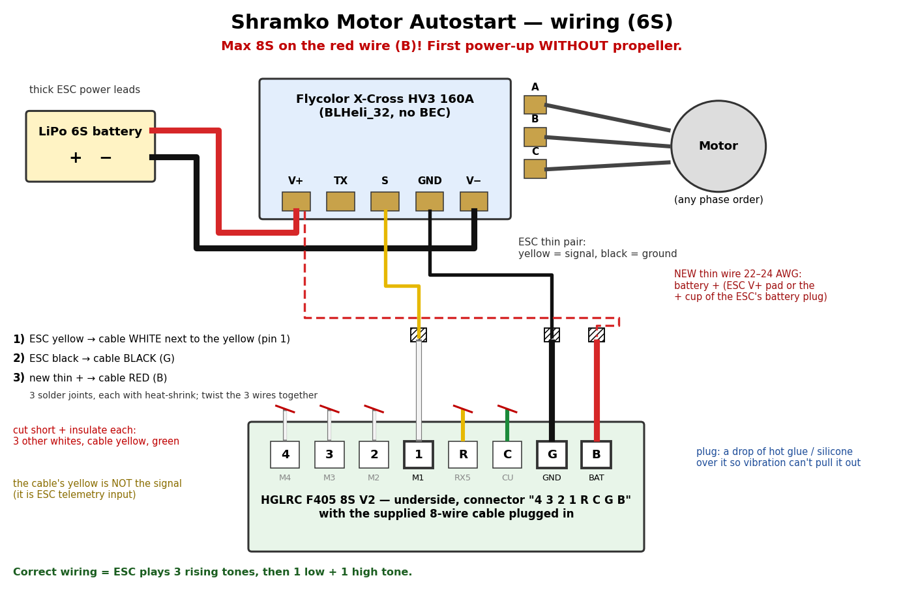

# Wiring: HGLRC F405 8S V2 + Flycolor X-Cross HV3 160A (6S)



## Parts

| Part | Facts that matter | Source |
|---|---|---|
| **HGLRC F405 8S V2** ("Direct Plug") | STM32F405, input **2–8S (7.4–33.6 V)**, power enters only through pin `B` of the 8-pin ESC connectors; Betaflight `board_name HGLRC_F405_S8` (vendor build) | HGLRC wiring diagram (Amazon B0H3KGV7BM), ht-dron.pl p10669, hobbydrone.cz "FC HGLRC F405 8S V2" |
| **Flycolor X-Cross HV3 160A 5-12S** | BLHeli_32 (target `Flycolor_X_Cross_HV3_G071`), **no BEC**, needs ≥ 5S, auto-detects PWM / Oneshot / Multishot / DShot at power-up, twisted-pair signal cable | Flycolor manual "HV 3 120-160A" (doc 251400-1163), fly-color.net, ht-dron.pl p9978 |

## ESC pads (battery edge): `V+ | TX | S | GND | V-`

| ESC | Function | Goes to |
|---|---|---|
| thick red / black | battery + / − | battery |
| **yellow** thin (middle pad `S`) | throttle signal | FC connector `4321RCGB`, pin **`1`** (motor 1 = PC9, TIM8 CH4) |
| **black** thin (pad `GND`) | signal ground | FC connector pin **`G`** |
| `TX` (empty) | KISS telemetry | optional → pin `R` (UART5 RX, PD2) + `feature ESC_SENSOR` |
| A / B / C | motor phases | motor, any order (direction is set in BLHeliSuite32 or via DShot commands) |

## FC underside connector `4321RCGB` (JST-SH 8-pin) and its cable

Silkscreen order `4 3 2 1 R C G B` = `M4 M3 M2 M1 RX5 CU GND BAT`. The supplied 8-wire cable, plugged in, has these colours (checked on the owner's board photo): **white, white, white, white, yellow, green, black, red**. Cut the far end off and make three joints (solder + heat-shrink each, twist the three wires together):

| Pin | Signal | Cable wire | Goes to |
|---|---|---|---|
| `1` | motor 1 | **white next to the yellow** | ESC **yellow** (signal, pad `S`) |
| `G` | ground | **black** | ESC **black** (pad `GND`) |
| `B` | board power in | **red** | **new** thin wire 22–24 AWG from battery + (ESC `V+` pad or the + cup of the ESC's battery plug) |
| `4 3 2 R C` | unused | 3 other whites, **yellow**, green | cut short, insulate **each** |

- The cable's **yellow is not the signal** — it is the ESC-telemetry input (UART5 RX). The ESC's yellow goes to a **white**.
- This build drives motors 1–4 with the same signal (`autostart_motors = 15`), so any of the four whites works; the one next to the yellow is pin 1.
- The FC's ground comes through the ESC's black signal wire: inside the ESC the `GND` pad is the battery minus, and the FC draws only ~0.1–0.2 A. There is no second ground path, so if a thick ESC lead ever comes loose no ESC current can flow through the thin wires or the FC.
- **Red = battery voltage.** Its joint must be fully insulated: battery + touching any white/yellow/green wire destroys the FC's processor.
- After plugging the cable in, put a drop of hot glue or neutral silicone over the plug so vibration cannot pull it out. Soldering directly to the connector's 1 mm-pitch legs is possible but not recommended; the 12 square pads along that edge have no documented pin map.

**Never put more than 8S on `B`.** For 10–12S feed `B/G` from a 12S-rated BEC (e.g. Matek BEC12S-PRO set to 12 V).

## Optional button

Top side, right pad column: **`RX4`** (UART4 RX = PA1) and the **`GND`** pad next to it. PA1 is not a boot/SWD/JTAG pin and only carries UART4 (GPS by default, unused here). The pad `BB-` (buzzer driver) is in the same row — do not bridge to it.

```
serial UART4 0 115200 57600 0 115200
resource SERIAL_TX 4 NONE
resource SERIAL_RX 4 NONE
resource AUTOSTART 1 A01
set autostart_mode = BUTTON      # or keep POWER: a click then stops / restarts the program
save
```

## First power-up checklist

1. Propeller **off**. Battery 6S.
2. ESC: 3 rising tones (alive) → 1 low (sees the FC signal) → 1 high (armed on zero throttle).
3. 10 s after power-on the motor starts and ramps for 10 s.
4. "7 low beeps" or a repeating 3-tone descending pattern = ESC not activated → PWM only: `set motor_pwm_protocol = PWM`, `set dshot_bidir = OFF`, `save`, replug the battery.

The HGLRC pin map is read from the vendor's wiring diagram and board silkscreen (no schematic is published); motor 1 = PC9 matches the Betaflight resource map read from the board.
